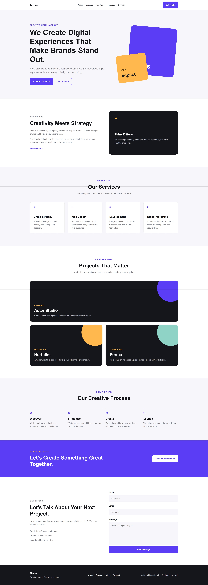
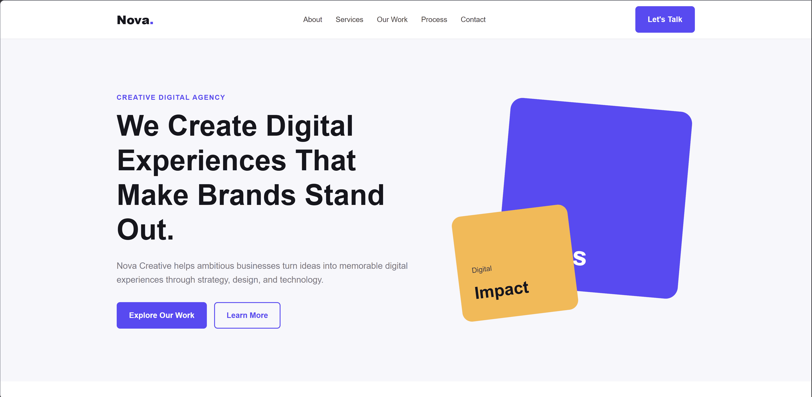

# Nova Creative Landing Page — Express.js

A responsive creative agency landing page built with Express.js, HTML, and CSS as part of my practical full-stack learning journey.

## Preview

### Full Page



### Hero Section



## About the Project

Nova Creative is a fictional creative digital agency landing page designed to practice building a complete responsive website with Express.js.

The project focuses on creating a polished frontend while using Express.js to serve the application and static assets.

This is the Express.js version of the Nova Creative landing page. I am also building the same project with Laravel to better understand how different backend frameworks approach a similar web application.

## Features

* Responsive landing page
* Hero section
* About section
* Services section
* Selected work section
* Creative process section
* Call-to-action section
* Contact section
* Footer
* Responsive navigation
* Mobile, tablet, and desktop layouts
* Custom favicon
* Semantic HTML structure
* Custom CSS styling

## Tech Stack

* Node.js
* Express.js
* HTML5
* CSS3
* Vanilla JavaScript

No frontend frameworks such as Bootstrap, Tailwind CSS, or React are used.

## Project Structure

```text
Nova-Creative-Landing-Page-Express.js/
├── src/
│   └── server.js
├── public/
│   ├── css/
│   │   └── style.css
│   ├── images/
│   │   └── favicon.png
│   └── index.html
├── screenshots/
│   ├── full-page.jpeg
│   └── hero-section.png
├── .gitignore
├── package.json
├── package-lock.json
├── LICENSE
└── README.md
```

## Getting Started

Clone the repository:

```bash
git clone https://github.com/Samiullah-Popalzai/Nova-Creative-Landing-Page-Express.js.git
```

Go into the project directory:

```bash
cd Nova-Creative-Landing-Page-Express.js
```

Install dependencies:

```bash
npm install
```

Start the development server:

```bash
npm run dev
```

Then open:

```text
http://localhost:3000
```

## Learning Goals

This project is part of my ongoing practice in full-stack web development.

The main goals are:

* Practice Express.js project structure
* Create an Express.js server
* Serve static files with Express
* Build responsive layouts with HTML and CSS
* Practice semantic HTML
* Improve frontend structure and styling
* Understand how Express.js handles a simple web application
* Compare Express.js with Laravel when building the same project

## Related Project

The same landing page is also implemented using Laravel.

**Laravel version:**

https://github.com/Samiullah-Popalzai/Nova-Creative-Landing-Page-Laravel

Building the same project in both Express.js and Laravel helps me compare their approaches while keeping the frontend concept similar.

## Author

**Samiullah Popalzai**

Full Stack Engineer & WordPress Developer
Kabul, Afghanistan

GitHub:
https://github.com/Samiullah-Popalzai

LinkedIn:
https://linkedin.com/in/Samiullah-Popalzai

Portfolio:
https://samiullah-popalzai.github.io

## License

Copyright © 2026 Samiullah Popalzai.

All rights reserved.

This repository is publicly available for viewing and educational or evaluation purposes, including portfolio and job application review.

The code may not be copied, modified, distributed, published, sublicensed, sold, or reused in other projects without prior written permission from the copyright holder.
